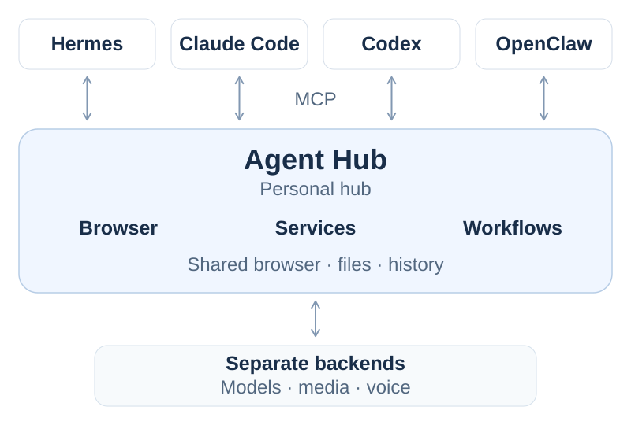
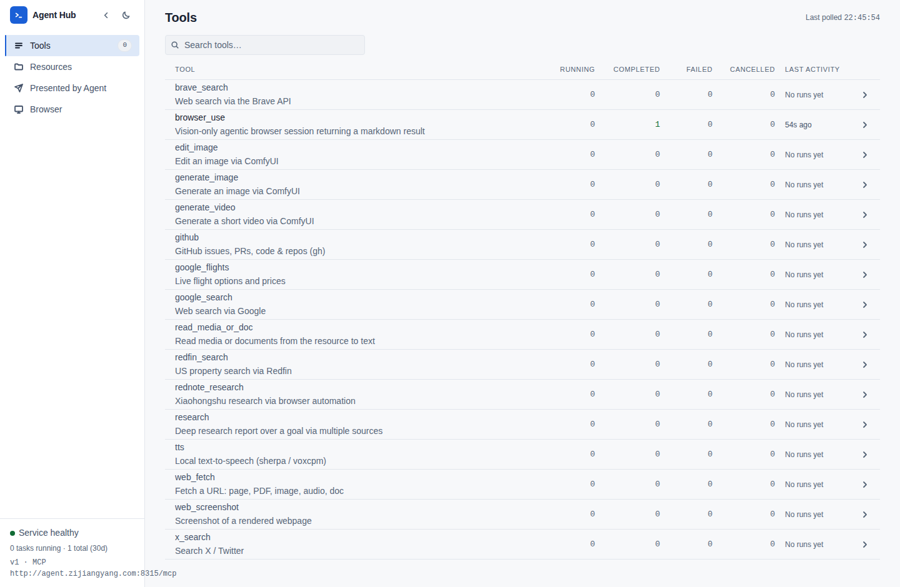
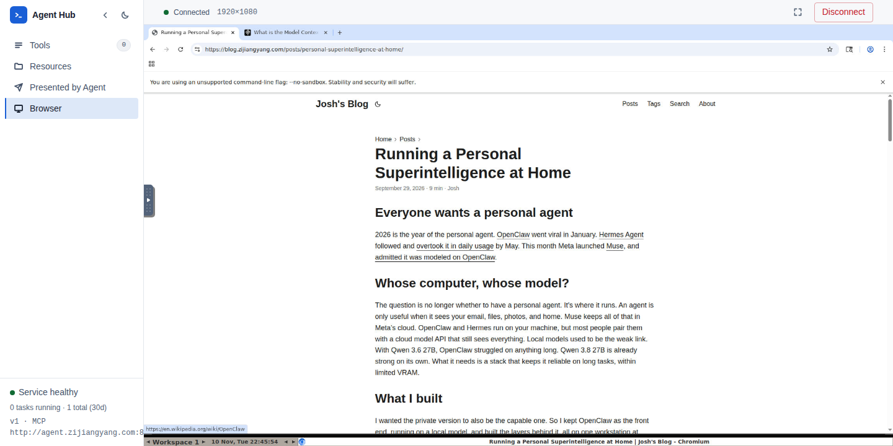
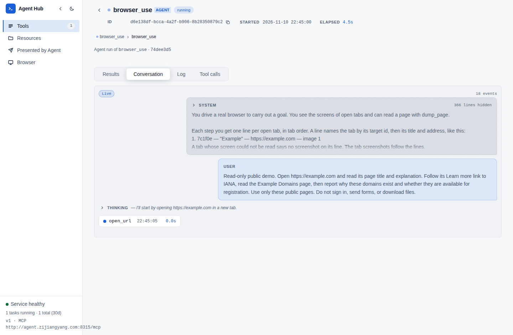

# Agent Hub: a stateful personal tool hub

Agent Hub is a **personal tool and workflow server** for the AI assistants you already use. It gives your assistant a signed-in browser, personal files, service adapters, and workflows for complete goals through [Model Context Protocol (MCP)](https://modelcontextprotocol.io/). Your assistant manages the conversation. Agent Hub does the work and returns the result to that assistant.

<p align="center">
  <a href="assets/readme/architecture.svg"></a>
</p>

Run one Agent Hub container on your trusted home infrastructure and connect your chosen MCP clients, such as Hermes, OpenClaw, OpenCode, Claude Code, or Codex. Browser identity, files, service adapters, and workflow settings stay with Agent Hub when you change assistants. Locally hosted model and media services are the intended setup, with those backends deployed separately from Agent Hub.

<p>
  <a href="assets/readme/dashboard.png"></a>
  <a href="assets/readme/browser.png"></a>
  <a href="assets/readme/workflow.png"></a>
</p>

Views: **Tool dashboard**, **Managed browser**, **Workflow live view**.

Click a view to open the full-size capture. The dashboard shows the tool registry and run activity. The browser and live workflow show an actual public-web demo in a clean, isolated environment.

## How you use it

You make a request in your chosen assistant. It calls an Agent Hub tool with the inputs or a complete goal, then uses the result in the same conversation. Agent Hub supplies three kinds of capability, each requiring its relevant [backends](#configuration):

| Capability | Request and result |
| --- | --- |
| **Your personal environment** | Sign into websites in the [managed browser](#sign-in-for-browser-jobs). Your assistant can delegate an operation on those sites to `browser_use`, which returns its status, summary, and any downloaded files. Uploaded documents and media are available to `read_media_or_doc` through resource paths. |
| **Adapters for your services** | Ask your assistant to generate an image or edit an uploaded one. Agent Hub calls your [ComfyUI API wrapper](#comfyui-backend), saves the output, and returns its resource path to the caller. Transcription and speech generation also connect to your configured services, supporting voice use in compatible front ends. These integrations do not require the browser. |
| **Workflows for complete goals** | Ask your assistant to research the best places to visit in Hawaii. It delegates the goal to `research`, whose own models and tools collect sources, draft, and review a cited report. The assistant retrieves the eventual report and answers you in the conversation where you asked. |

Long browser and research tasks run inside purpose-built harnesses with their own model calls, context, and validation. The interface assistant delegates a goal instead of keeping every browsing or research step in its main loop. This structure is intended to make long, judgment-heavy tasks more manageable with local models. Results still depend on your configured models, services, and the task.

Slow tools return a `task_id` so the calling assistant can follow the run and retrieve its result. Resource paths identify files used or produced by a tool. Your front end controls waiting and result delivery to your conversation. See [the CLI example](#try-a-tool-from-the-command-line) for manual inspection.

## Why a separate tool service?

**Set up the capabilities once and use them from any connected harness.** Each client points at the same MCP URL and uses the same tool and workflow implementations. A tool fix reaches every client without copying its implementation, backend settings, or browser runtime into each harness. Each client still needs its own MCP connection configuration. Agent Hub's workflow models are configured separately from the assistant's own model.

The clients independently reuse the same capabilities and personal environment. Their conversations and memory remain in their respective harnesses.

Installing these capabilities directly in Hermes or Claude Code is a valid choice for one dedicated harness. A separate service helps when you want to reuse your own adapters and workflow runtimes across assistants, keep the heavy browser environment in one place, and retain the setup when you change front ends.

Mounts retain the browser profile, files, and task records across container recreation, subject to [retention](#files-and-persistence). A restart preserves saved files, logs, and results in those mounts, but interrupted workflows do not automatically resume. This is shared personal state, without isolation between agents or users. Coordinate browser jobs that could interfere with each other. Keep access to trusted clients on localhost or a private home LAN or VPN. See [Deployment and access](#deployment-and-access) for the default access settings.

## Who it is for

Agent Hub suits technical users who want to connect an existing assistant to a personal tool stack, and developers who want to adapt those tools and workflows. Bring the model and media services needed by the capabilities you choose. They can run elsewhere in your home stack, and supported backend settings also accept remote endpoints. The Agent Hub image does not bundle those model servers, and configuring a model in your assistant does not configure Agent Hub's workflows.

I maintain Agent Hub for my own personal workflow and home stack. It requires setup rather than providing a turnkey assistant. Forks and modifications are welcome under the applicable [licenses](#license), including commercial use. I do not promise compatibility or support across arbitrary providers, models, platforms, or use cases.

## Try it locally

The current Dockerfile targets Linux x86-64. You need Docker, network access for image dependencies and model downloads, and model services for the capabilities you want to use. A Python-only installation does not provide the browser, desktop, and document conversion dependencies in the image.

Agent Hub uses one shared browser profile and does not require application authentication by default. Connect only trusted clients and keep the service private. See [Deployment and access](#deployment-and-access) before exposing it to other machines.

The CloakBrowser wrapper is MIT-licensed, but its downloaded Chromium binary has [separate proprietary terms](https://raw.githubusercontent.com/CloakHQ/CloakBrowser/v0.6.3/BINARY-LICENSE.md). Listing it as a dependency is permitted. Redistributing or bundling the binary, or providing browser functionality to third-party customers, may require a separate agreement. The Dockerfile downloads that binary into the image, so publishing this source does not grant permission to redistribute the whole image. See [third-party notices](THIRD_PARTY_NOTICES.md) before distribution or hosted use.

These commands are for a standalone checkout. From its root, create the configuration and persistent folders:

```bash
cp .env.example .env
mkdir -p models data/cloakbrowser
```

Edit `.env` before starting. Every setting in the template is commented out, so copying it alone does not configure a model backend. For browser automation, configure an OpenAI-compatible reasoning backend with image input and tool calling support, for example:

```dotenv
REASON_BACKEND_URL=https://llm.example.com/v1
REASON_MODEL=your-vision-model
REASON_API_KEY=your-api-key
DAV_BASE_URL=http://localhost:8315
```

Replace the example values with your service's settings. See [Configuration](#configuration) for other capabilities. The console and tool discovery can run without model services, but tools that need them will fail until configured.

Build the image and start a container that exposes only the application port on the local host:

```bash
docker build -t agent_hub:local .
docker run -d --name agent_hub \
  --env-file .env \
  -e MODELS_DIR=/app/models \
  -p 127.0.0.1:8315:80 \
  --shm-size=1g \
  -v "$(pwd)/.env:/app/.env:ro" \
  -v "$(pwd)/models:/app/models" \
  -v "$(pwd)/data:/app/data" \
  -v "$(pwd)/data/cloakbrowser:/root/.config/google-chrome-ai" \
  agent_hub:local
```

The browser command in [`supervisor.conf`](supervisor.conf) names a specific Chromium installation directory. If `cloakbrowser install` downloads a different version during the build, adjust that command to the installed path and rebuild. Check `docker logs agent_hub` and the container's `/root/log/` files if a service does not start.

The checked-in [`docker-compose.yml`](docker-compose.yml) is a development deployment with an NVIDIA GPU reservation and additional desktop/debug ports. It needs an NVIDIA-enabled Docker runtime as written, even though the application's local inference uses the CPU. The standalone command above does not request a GPU.

Once the server is ready:

```bash
curl --fail http://localhost:8315/api/health
```

Open the console at **http://localhost:8315/**. Connect an MCP client using **Streamable HTTP** and the URL **http://localhost:8315/mcp**. The configuration field names depend on your client.

### Sign in for browser jobs

For tasks that use websites, open the console's **Browser** page at **http://localhost:8315/browser** to interact with the managed desktop and sign in to the websites you want your agent to use. Browser tools use this same browser and its login state, including on dynamic and authenticated pages. Sites may still require you to sign in again or complete additional verification.

The command above mounts `data/cloakbrowser/` at the browser's profile directory, `/root/.config/google-chrome-ai`. Keep that folder to retain browser state across container recreation and MCP client connections. This is one shared personal browser profile for the service, so connect only trusted clients. See [Deployment and access](#deployment-and-access) before exposing it to other machines.

### Try a tool from the command line

The CLI runs on the host and needs the MCP SDK and HTTPX. With Python 3.12 or newer:

```bash
python3 -m venv .venv
. .venv/bin/activate
python -m pip install 'mcp==1.30.0' httpx
python scripts/agent_cli tools list
python scripts/agent_cli tools show browser_use
python scripts/agent_cli tools call send_or_receive_file
```

The last command returns file transfer instructions without calling a model. Together with health and tool discovery, it checks the connection before you configure model services.

After configuring the browser's reasoning backend, this is a smoke test:

```bash
python scripts/agent_cli tools call browser_use \
  --prompt 'Open https://example.com and report the page title.'
```

For a browser goal, sign into a site you use and give your assistant the site URL, the operation to perform, and the output you need. It can delegate the complete task to `browser_use` and use the returned result in your conversation.

Slow tools return an acknowledgement with a `task_id`. Substitute that ID to follow the run:

```bash
python scripts/agent_cli tools call task --action status --task_id YOUR_TASK_ID
python scripts/agent_cli tools call task --action result --task_id YOUR_TASK_ID
python scripts/agent_cli tools call task --action logs --task_id YOUR_TASK_ID --tail 20
```

Results and logs support character offsets for reading large outputs. Research can take hours, so provide a complete goal and inspect its progress in the console. Set the host environment variable `MCP_URL` to point the CLI at a different server.

## What it does

| Capability | Examples |
| --- | --- |
| Signed-in browser | Delegate a browser goal to `browser_use` using the managed browser and its signed-in profile. Capture pages with `web_screenshot`. |
| Search and research | Search the web, GitHub, X, Xiaohongshu, flights, and US property listings. Use `research` for a multi-source report with citations. |
| Document and media reading | Fetch URLs with `web_fetch`, or read uploaded PDFs, images, office documents, audio, and video with `read_media_or_doc`. |
| Media creation | Generate or edit images and generate videos through a separately configured [ComfyUI API wrapper](#comfyui-backend). |
| Voice and audio | Transcribe audio through `read_media_or_doc` and a configured ASR service. Generate speech with `tts` or the [OpenAI-style speech endpoint](#deployment-and-access), using your configured TTS server. |
| File exchange | Upload inputs and download outputs through WebDAV, read text through MCP resources, and present results in the browser. |
| Run inspection | View status, logs, results, and subtasks in the console. Use `task` to follow or cancel long-running work. |

The application uses Python 3.12+, FastMCP, Playwright/Patchright, ONNX Runtime, Transformers, and Ultralytics. The Docker image includes a managed Chromium browser, a virtual desktop, and document conversion utilities. Local detection and classification run on the CPU. LLM reasoning, speech services, embeddings, reranking, and ComfyUI require separately configured services, which may run locally or remotely.

### Browser behavior

Plain HTTP fetching is useful for public content. The managed browser also supports JavaScript and the interactive signed-in sessions you establish, with saved state in its persistent profile.

It uses CloakBrowser's patched Chromium. The [browser manager](app/lib/browser/browser_manager.py) applies CloakBrowser's [default humanization patches](https://github.com/CloakHQ/CloakBrowser/blob/v0.6.3/cloakbrowser/human/config.py) for mouse movement, clicks, typing, and scrolling. If they cannot initialize, the browser continues without them. Sites can still detect automation, restrict access, or require additional verification.

## Configuration

[`.env.example`](.env.example) documents the settings, optional model names and API keys, persistence paths, and when a restart or container recreation is needed. Configure only the capabilities you intend to use.

These model settings belong to Agent Hub's embedded workflows and tools. Configuring a model in your outer harness does not configure the server's browser reasoning, research, transcription, or speech services. The image does not bundle those model servers. Choose local endpoints if you want those requests to stay on your own infrastructure, and check the data handling of any remote services you configure.

| Capability | Services or credentials |
| --- | --- |
| General reasoning and visual browser automation | `REASON_BACKEND_URL`, with `REASON_MODEL` and `REASON_API_KEY` as needed. Browser automation prefers `REASON_THINKING_BACKEND_URL` when configured and otherwise uses this backend. |
| Deep research | `REASON_THINKING_BACKEND_URL`, `EMBEDDING_SERVER_URL`, and `RERANKER_SERVER_URL`, plus the services needed by its search sources. See [Research setup and service contracts](#research-setup-and-service-contracts) for the minimum web-research setup. |
| OCR | `OCR_BACKEND_URL`. Without it, image and PDF reading rely on the reasoning model. |
| Audio and video transcription | `ASR_SERVER_URL`. |
| Speech generation | `LOCAL_TTS_URL`, both `LOCAL_TTS_VOICE_EN` and `LOCAL_TTS_VOICE_ZH`, and a reasoning backend for text preparation. Set `LOCAL_TTS_MODEL` if required by the speech server. |
| Image and video generation | `COMFYUI_BACKEND_URL`, pointing to the required [synchronous ComfyUI API wrapper](#comfyui-backend), with the workflow nodes and model files installed on its backend. |
| Search integrations | `BRAVE_SEARCH_API_KEY` for Brave. `GITHUB_TOKEN` or an authenticated `gh` session in the container for GitHub. X search needs an authenticated session. |
| HTML block-page checks | `LAYA_SERVER_URL`, required when reading HTML URLs through the resolver. If the configured classifier cannot check a page, the resolver falls back to the browser. |

Reasoning and OCR endpoints use OpenAI-compatible chat completions APIs. Embeddings use the embeddings API. Laya and reranking require the specific contracts below, which an OpenAI-compatible chat server does not necessarily implement.

Set `DAV_BASE_URL` to an address reachable by your MCP clients. `localhost` inside another container refers to that container, so the default address will not work for every deployment. `CONSOLE_BASE_URL` controls console links and defaults to the same base URL.

### Research setup and service contracts

For the Hawaii web-research example, configure `REASON_THINKING_BACKEND_URL` for the collector, writer, and reviewer, plus `REASON_BACKEND_URL` for Google search and page reading. Research does not fall back from the thinking backend to the general backend. Both settings can point to the same service and model if it supports the required chat completions, tool calling, structured output, and image input. Their model names and API keys are configured separately through the corresponding `*_MODEL` and `*_API_KEY` settings.

Also supply an embedding service, a reranker, and Laya for reading HTML sources. Google search uses the managed browser and general reasoning model without a search API key. Brave needs `BRAVE_SEARCH_API_KEY` if used. GitHub needs `GITHUB_TOKEN` or container-side `gh` authentication, X needs the `bird` CLI with authentication, and Xiaohongshu may require signing into the managed browser. Those additional sources are not prerequisites for a public-web report. Ask for public web sources if that is your configured scope, though the collector still has the other tools available.

Agent Hub does not bundle deployments of Laya, embeddings, or reranking. This repository provides no standalone setup link for Laya or a particular reranker implementation. Supply compatible services or adapters using these contracts. The linked source files define what this version of Agent Hub sends and reads:

| Service | Request and response expected by Agent Hub |
| --- | --- |
| Embeddings | Set `EMBEDDING_SERVER_URL` to the service base URL, with or without `/v1`. Agent Hub sends `POST /v1/embeddings` with `model` and a string `input`, and reads `data[0].embedding`. Each vector must contain **1024 numbers**. Agent Hub does not request a dimension override. Set `EMBEDDING_MODEL` and `EMBEDDING_API_KEY` as needed. See [evidence store](app/agents/research/evidence.py). |
| Reranker | Set `RERANKER_SERVER_URL` to the base URL, with or without `/v1`, such as `http://reranker.example.com:8000`. Agent Hub sends `POST /v1/rerank` with JSON such as `{"model":"your-reranker","query":"travel question","documents":["source text"]}`. The response must have a `results` array such as `{"results":[{"index":0,"relevance_score":0.9}]}`, with zero-based document indices. `score` is also accepted instead of `relevance_score`. Set `RERANKER_MODEL` for the request's model name, otherwise it sends `default`. `RERANKER_API_KEY`, when set, is sent as a Bearer token. See [ranking client](app/agents/research/evidence.py). |
| Laya HTML classifier | Set `LAYA_SERVER_URL` to the base URL **without `/v1`**, such as `http://laya.example.com:8000`. Agent Hub sends `POST /v1/classify` with JSON such as `{"html":"<html><body>Page content</body></html>"}`. It requires HTTP 200 and an object such as `{"blocked":false,"blocked_probability":0.02}`, with a boolean `blocked` and numeric `blocked_probability`. No authentication header is configured. See [Laya client](app/lib/laya/client.py). |

The [backend configuration](app/lib/shared/config.py) normalizes model-service URLs to end in `/v1`, so a reranker exposing only `/rerank` needs an adapter or matching route. Embeddings and research chat calls send model `default` and a placeholder key when those settings are omitted, so configure real values if your service requires them. Reranking has no unranked fallback when its request fails. Failed evidence writes are logged and dropped, so a reachable embedding endpoint with the wrong vector size still leaves research without that evidence.

For HTML reads through `web_fetch` or `read_media_or_doc`, an unset `LAYA_SERVER_URL` causes failure. A configured service reporting a blocked page, returning an error or invalid response, or being unreachable triggers the [resolver's browser fallback](app/lib/resolver/resolver.py). That fallback still needs a working browser and reasoning backend. Direct browser automation and local PDF reading do not need Laya.

### ComfyUI backend

Image and video generation require ComfyUI behind the [SaladTechnologies `comfyui-api` wrapper](https://github.com/SaladTechnologies/comfyui-api/blob/1.17.1/README.md#using-synchronously). Set `COMFYUI_BACKEND_URL` to the wrapper's base URL, for example `http://comfyui-api:3000`. Agent Hub sends a workflow to `/prompt` and expects the completed media in the same response. The [native ComfyUI API](https://docs.comfy.org/development/comfyui-server/comms_routes) queues the workflow instead and is incompatible with this client.

Run this backend separately from Agent Hub, with support for the nodes and model files in [`app/lib/comfyui/workflows.py`](app/lib/comfyui/workflows.py). The Agent Hub image does not install this backend or its models. [`.env.example`](.env.example) lists the model filenames and `COMFYUI_*` overrides.

For image edits and image-guided videos, the wrapper [downloads reference-image URLs](https://github.com/SaladTechnologies/comfyui-api/blob/1.17.1/README.md#image-to-image-workflows) from Agent Hub's WebDAV endpoint. `DAV_BASE_URL` must therefore also be reachable from the wrapper service.

### Model files

Most local helper models download on first use. Two optional assets need manual preparation under `models/` to enable these additional behaviors:

- **Document-image OCR routing:** save `onnx/model_quantized.onnx` from the [Mozilla/docornot model repository](https://huggingface.co/Mozilla/docornot/tree/main/onnx) as `models/document_classifier.onnx`. The [image reader](app/lib/reason/describe_image.py) uses it to recognize document images and send them to `OCR_BACKEND_URL`, including scanned PDF pages processed as images by `read_media_or_doc` and `web_fetch`. Without the classifier, images count as pictures and use the vision reasoning model instead. PDFs with sufficient extractable text bypass this image path. Browser automation and the console do not need this asset.
- **Text-format detection for previews:** copy the installed Magika package's `models/standard_v3_3` directory to `models/magika/standard_v3_3/`, including `model.onnx` and its companion files. The [text detector](app/lib/text_type/detector.py) identifies formats and code languages for console results, resource previews, and `present_to_user` content. Without it, content-based text-format and language detection is unavailable. Filename-based formats, console JSON/JSONL result detection, explicitly declared formats, and binary detection still work. Unknown `present_to_user` content defaults to Markdown. Browser automation and PDF reading do not need this asset.

See the `MODELS_DIR` notes in [`.env.example`](.env.example). Model files are not included in Git. Downloads, model services, and helper models can have their own access requirements and license terms.

## Files and persistence

Upload a file to the writable `upload/` folder, then pass its relative path, such as `upload/document.pdf`, to a tool:

```bash
curl --fail -T document.pdf http://localhost:8315/dav/upload/document.pdf
```

Download an output using the path returned by the tool:

```bash
curl --fail -o /tmp/result.png http://localhost:8315/dav/media_gen/result.png
```

Replace `media_gen/result.png` with the actual output path. Only `upload/` is writable through WebDAV. Text files can also be read as MCP resources using `resources:///<path>`.

The `data/` mount retains resource files, SQLite run records, and logs/results for tracked tasks. The additional `data/cloakbrowser/` mount retains the browser profile. These belong to the service and are shared by its connected clients, rather than isolated per harness or user. The separate `models/` mount retains helper models. Resource files that have not been used or written for 30 days are automatically deleted. Listing files or viewing thumbnails does not renew retention, so copy important outputs elsewhere.

## Deployment and access

The application serves MCP at `/mcp`, the console at `/`, WebDAV at `/dav`, and a speech endpoint at `/v1/audio/speech` on the same HTTP port. The speech endpoint accepts OpenAI-style `input` and `response_format` fields and uses the configured English or Chinese voice.

MCP, the console, and WebDAV do not require authentication by default. A connected client can delegate actions using the managed browser's signed-in sessions, access personal page content, and read service resources and run records. Use trusted clients, keep the service on localhost or a private network, and put authenticated access controls in front of any public deployment. The stock Compose file publishes VNC, noVNC, and Chrome debugging ports on all host interfaces, and VNC is configured without a password. Restrict those ports before using that deployment on a shared network.

The separate container gives the service its own runtime and lifecycle. It does not guarantee a sandbox for untrusted code or network privacy. Browser screenshots, page content, documents, and other inputs may be sent to the configured model services during tool execution, even when the outer assistant uses a local model.

## Development

Production source is under `app/`, host utilities under `scripts/`, and tests under `tests/`. Read [`AGENTS.md`](AGENTS.md) for the worktree, review, deployment, and testing conventions used in this repository.

For an existing development deployment, run affected application unit tests through the wrapper:

```bash
bash scripts/run_tests.sh -m 'not live' tests/app
```

The wrapper starts the development container if needed and selects the correct checkout or worktree. Running it without a marker filter includes slow live tests. Tests under `tests/scripts/` run on the host instead, because they call the host-facing service port.

## License

Agent Hub's original project code is licensed under the **GNU Affero General Public License, version 3 only** (`AGPL-3.0-only`). See [LICENSE](LICENSE) for the full text and [THIRD_PARTY_NOTICES.md](THIRD_PARTY_NOTICES.md) for imported code, assets, and dependency exceptions. Existing third-party license grants remain in effect.

The AGPL permits commercial use. Distribution carries license, notice, and corresponding-source obligations. If you modify the program and let users interact with it over a network, section 13 requires a prominent offer of the corresponding source of that version to those users, at no charge. Read the license for the full conditions.

Model weights, data, external services, and runtime dependencies retain their own terms. The project license does not grant rights to redistribute every component installed by the Dockerfile.
